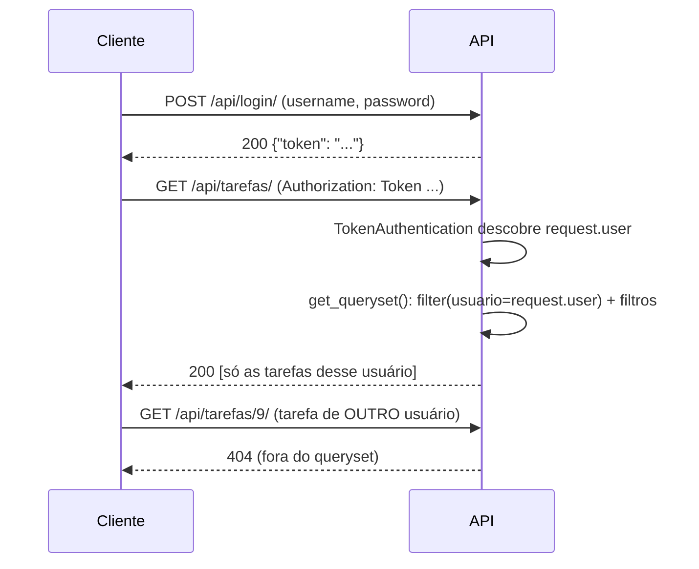

# ✅ API de Tarefas — Projeto 3 (Django REST Framework)

API REST de tarefas pessoais com **login por Token**, onde **cada usuário só enxerga e altera as próprias tarefas**. Projeto da disciplina **Construção de Backend** (IESB), seguindo o *Guia do Aluno — Projeto 3*, mais os desafios extras.

> **Status:** projeto completo, **30 testes automatizados passando** (os 8 do guia + 22 dos extras), as **9 verificações manuais do passo 9 executadas contra o servidor (9/9 OK)** e configuração de produção testada com gunicorn. O envio ao GitHub e o deploy dependem da sua conta; o passo a passo está em [Publicação](#-publicação).

---

## 📑 Sumário
1. [Funcionalidades](#-funcionalidades)
2. [Tecnologias e estrutura](#-tecnologias-e-estrutura)
3. [Como rodar](#-como-rodar-no-windows)
4. [Referência da API](#-referência-da-api)
5. [Passo a passo da construção](#-passo-a-passo-da-construção)
6. [Desafios extras](#-desafios-extras-o-que-foi-acrescentado)
7. [Dificuldades encontradas](#-dificuldades-encontradas)
8. [Fluxo de funcionamento (com prints)](#-fluxo-de-funcionamento-com-prints)
9. [Exemplos reais de request e response](#-exemplos-reais-de-request-e-response)
10. [Checklist de entrega](#-checklist-de-entrega)
11. [Publicação](#-publicação)
12. [Limitações e próximos passos](#-limitações-e-próximos-passos)

---

## ✅ Funcionalidades

**Do guia**
- Login por Token: `POST /api/login/`.
- Criar e listar tarefas, **sempre só as do usuário logado**.
- Filtros `?concluida=` e `?prioridade=`.
- Ver, editar (`PUT`/`PATCH`) e apagar uma tarefa pelo ID.
- `401` sem token e `404` para a tarefa de outro usuário.

**Extras** (detalhes [mais abaixo](#-desafios-extras-o-que-foi-acrescentado)): paginação opcional, ordenação, busca, subtarefas, estatísticas, tarefas atrasadas, data de conclusão automática, cadastro de usuário, logout, API navegável, comando de dados de demonstração e configuração de deploy.

---

## 🧰 Tecnologias e estrutura

Python 3.12 · Django 6.1 · Django REST Framework 3.18 · SQLite (padrão) ou PostgreSQL via `DATABASE_URL` · WhiteNoise + gunicorn (produção).

```
Projeto 3/
├── manage.py
├── requirements.txt · .gitignore · README.md
├── Procfile · render.yaml           # deploy (extra)
├── todoapi/                         # pacote de configuração (mesmo nome do projeto: é normal)
│   ├── settings.py · urls.py · wsgi.py
└── tarefas/
    ├── models.py                    # Tarefa
    ├── serializers.py               # TarefaSerializer, RegistroSerializer
    ├── views.py                     # lista/cria, detalhe, estatísticas, registro, logout
    ├── urls.py · admin.py · pagination.py
    ├── tests.py                     # os 8 testes do guia, exatamente como no PDF
    ├── tests_extras.py              # 22 testes dos desafios extras
    ├── migrations/
    └── management/commands/popular_dados.py
docs/                                # prints e scripts que os geram
```

> A pasta raiz se chama `Projeto 3` (como no projeto anterior) em vez de `todoapi/` do guia. Pode renomear: nada no código depende do nome da pasta raiz.

---

## 🚀 Como rodar (no Windows)

```bat
cd "C:\Users\caios\OneDrive\Documentos\Faculdade\Projeto 3"
python -m venv venv
venv\Scripts\activate
pip install -r requirements.txt
python manage.py migrate
python manage.py createsuperuser
python manage.py popular_dados --senha SUASENHA    :: opcional: cria ana e beto com tarefas de exemplo
python manage.py runserver
```

- API: `http://127.0.0.1:8000/api/tarefas/` · Admin: `/admin/` · API navegável: faça login em `/api-auth/login/`.
- Testes: `python manage.py test` (tudo) ou `python manage.py test tarefas.tests` (só os 8 do guia).
- Variáveis de ambiente (todas opcionais em desenvolvimento): `SECRET_KEY`, `DEBUG`, `ALLOWED_HOSTS`, `CSRF_TRUSTED_ORIGINS`, `DATABASE_URL`.

---

## 📖 Referência da API

Todas as rotas exigem o cabeçalho `Authorization: Token <código>`, exceto login e registro.

| Método e rota | O que faz |
|---|---|
| `POST /api/login/` | Recebe `username` e `password`; devolve `{"token": "..."}` |
| `POST /api/registro/` | **Extra.** Cria usuário (valida senha) e devolve o token |
| `POST /api/logout/` | **Extra.** Invalida o token atual (204) |
| `GET /api/tarefas/` | Lista **só as tarefas do usuário logado** |
| `POST /api/tarefas/` | Cria tarefa; o dono vem do token |
| `GET/PUT/PATCH/DELETE /api/tarefas/<id>/` | Detalhe, edição e remoção. Tarefa de outro usuário: **404** |
| `GET /api/tarefas/estatisticas/` | **Extra.** Resumo das tarefas do usuário |

**Parâmetros da listagem**

| Parâmetro | Exemplo | Efeito |
|---|---|---|
| `concluida` | `?concluida=false` | Só pendentes (ou `true`: só concluídas) |
| `prioridade` | `?prioridade=Alta` | `baixa`, `media` ou `alta` (aceita qualquer caixa) |
| `atrasada` *(extra)* | `?atrasada=true` | Vencidas e ainda pendentes |
| `raiz` *(extra)* | `?raiz=true` | Só tarefas principais (sem tarefa pai) |
| `search` *(extra)* | `?search=drf` | Busca no título e na descrição |
| `ordering` *(extra)* | `?ordering=-data_limite` | Ordena por `data_limite`, `data_criacao`, `titulo` ou `prioridade` |
| `page`, `page_size` *(extra)* | `?page_size=5&page=2` | Paginação (só ativa quando um dos dois é enviado) |

Os filtros se combinam: `?concluida=false&prioridade=alta&ordering=data_limite`.

---

## 🛠️ Passo a passo da construção

Seguindo as 11 etapas do guia. Cada checkpoint foi realmente executado.

| # | Etapa | O que foi feito | Checkpoint |
|---|---|---|---|
| 1 | Ambiente e DRF | Pasta, venv, `pip install django djangorestframework`, `startproject todoapi .` e `startapp tarefas` | `runserver` sobe sem erros |
| 2 | Registrar apps | `rest_framework`, `rest_framework.authtoken` e `tarefas` em `INSTALLED_APPS` | `check` → *no issues* |
| 3 | Model `Tarefa` | `ForeignKey` para o usuário (`related_name='tarefas'`), `choices` de prioridade, `Meta.ordering` | — |
| 4 | Migrations e Admin | `makemigrations tarefas` + `migrate`; `TarefaAdmin`; superusuário e usuários `ana` e `beto` | *Create model Tarefa* |
| 5 | Serializer | `ModelSerializer` com `usuario` **somente leitura** (o dono nunca vem do cliente) | — |
| 6 | Views | `ListCreateAPIView` e `RetrieveUpdateDestroyAPIView`; `get_queryset()` isola por usuário e aplica filtros; `perform_create()` grava o dono | — |
| 7 | URLs | Rotas do app e `obtain_auth_token` em `/api/login/` | — |
| 8 | Autenticação | `REST_FRAMEWORK` com `TokenAuthentication` + `IsAuthenticated` por padrão | `check` sem erros |
| 9 | Teste manual | As 9 verificações com duas contas, executadas por script contra o servidor | **9/9 OK** ([print 10](#10-as-9-verificações-do-passo-9)) |
| 10 | Testes automatizados | `tests.py` do guia | `Ran 8 tests … OK` |
| 11 | GitHub | `pip freeze`, `.gitignore`, este README, `git init` e commit | ver [Publicação](#-publicação) |

Depois do guia, construí os extras (próxima seção) e testei cada um.

---

## ⭐ Desafios extras: o que foi acrescentado

**Os 5 do guia**

| Desafio | Como foi feito |
|---|---|
| **Paginação** | `PaginacaoOpcional` (`pagination.py`): resposta vira `{count, next, previous, results}` quando se envia `?page=` ou `?page_size=` ([por que opcional](#-dificuldades-encontradas)) |
| **Ordenação** | `OrderingFilter` com `?ordering=data_limite` e `-data_limite` (também `data_criacao`, `titulo`, `prioridade`) |
| **Subtarefas** | `tarefa_pai = ForeignKey('self', related_name='subtarefas')`; o serializer só aceita pai **do próprio usuário** e **bloqueia ciclos** |
| **Estatísticas** | `/api/tarefas/estatisticas/` com `aggregate()` + `Count(filter=Q(...))`: total, concluídas, pendentes, atrasadas, vencem hoje, taxa de conclusão e pendentes por prioridade |
| **Deploy** | Configuração por variáveis de ambiente (`SECRET_KEY`, `DEBUG`, `ALLOWED_HOSTS`, `DATABASE_URL`), WhiteNoise, gunicorn, `Procfile` e `render.yaml` (**o deploy em si não foi feito**) |

**Extras criados por mim**, para a API não ficar incompleta

| Extra | Por que faz sentido |
|---|---|
| `POST /api/registro/` | Sem isso só dá para criar usuário pelo Admin; valida a senha com as regras do Django |
| `POST /api/logout/` | O token não ficaria preso para sempre: o logout o apaga |
| Campo `data_conclusao` (automático) | Registra *quando* a tarefa foi concluída; some se ela for reaberta; o cliente não consegue forjar |
| Campo calculado `atrasada` + `?atrasada=true` | `@property` sem coluna no banco, como `esta_atrasado` do Projeto 2 |
| `?search=` e `?raiz=true` | Achar tarefas rápido e listar só as principais |
| API navegável (`/api-auth/login/`) | Permite usar e **mostrar** a API no navegador, sem Postman |
| `popular_dados --senha` | Cria `ana` e `beto` com tarefas variadas para demonstrar o isolamento |

---

## 🧗 Dificuldades encontradas

Registro dos problemas reais e das decisões que tomei.

1. **Paginação global quebraria os testes do guia.** O `tests.py` do professor percorre `r.data` como uma lista. Com `PageNumberPagination` ativo no `REST_FRAMEWORK`, `r.data` vira um dicionário e o teste falha. Solução: `PaginacaoOpcional`, ativa só com `?page=`/`?page_size=`. Assim a resposta padrão continua um array (como no guia) e a paginação funciona quando pedida.
2. **Subtarefas abriam uma brecha de segurança.** O campo `tarefa_pai` padrão aceita o ID de *qualquer* tarefa. Um usuário poderia ligar sua tarefa à de outra pessoa e ainda descobrir que aquele ID existe pela mensagem de erro, o que é exatamente o que o guia quer evitar com o `404`. Criei `TarefaPaiField`, que só enxerga as tarefas do próprio usuário: ID alheio e ID inexistente recebem **a mesma resposta** (há teste para isso).
3. **Subtarefas podem formar ciclos** (A é pai de B, B é pai de A). Adicionei `validate_tarefa_pai`, que sobe a cadeia de ancestrais e recusa o ciclo (testes `test_nao_permite_ciclo`).
4. **O critério do teste 7 do guia ("só `concluida` mudou") conflita com um extra.** Com `data_conclusao` automática, o `PATCH` altera dois campos. O segundo é derivado do primeiro e preenchido pelo servidor, então mantive o extra e o script de verificação aceita exatamente esse par (`concluida` e `data_conclusao`). O teste automatizado do guia continua passando sem alteração.
5. **`PUT` não "zera" os campos opcionais.** Eu esperava que um `PUT` sem `descricao` a apagasse. Na prática o DRF exige apenas os campos **obrigatórios** (`titulo`); os opcionais omitidos mantêm o valor atual. A diferença para o `PATCH` é a obrigatoriedade, não o "reset". Descobri isso quando meu próprio teste falhou e corrigi a *expectativa*, não o código.
6. **Testes lentos.** Os 8 testes levavam ~15 s porque `create_user` faz hash PBKDF2 (propositalmente lento). Em `manage.py test` o `settings.py` passa a usar `MD5PasswordHasher`, e a suíte rodou em menos de 1 s. Em uso normal e em produção o hasher seguro continua ativo.
7. **Como tirar prints de uma API sem tela.** O guia usa Insomnia/Postman, que não consegui automatizar. Usei a **API navegável do DRF**, que exige sessão. Acrescentei `SessionAuthentication` *depois* de `TokenAuthentication` na lista, o que mantém o `401` sem token (teste do guia passa) e libera o navegador. A tabela do passo 9 foi gerada a partir de dados reais do script de verificação.
8. **Tokens e senhas não podem aparecer.** O guia proíbe token ou senha de teste no README. Os scripts mascaram o token (`***`), os exemplos usam `<TOKEN>` e o `popular_dados` **exige** `--senha`, sem senha padrão no repositório.
9. **Ordenação depende do banco.** `?ordering=prioridade` segue a ordem alfabética do valor gravado (`ALTA`, `BAIXA`, `MEDIA`), não a ordem de importância. E, em `data_limite`, tarefas sem prazo (nulo) aparecem no início no SQLite e no fim no PostgreSQL. Deixei como está e documentei.
10. **Mensagens de erro em inglês.** Mantive `LANGUAGE_CODE` padrão para os erros (`Authentication credentials were not provided`) coincidirem com a tabela "Erros comuns" do guia. O fuso foi ajustado para `America/Sao_Paulo`, porque `atrasada` depende da data local.
11. **PostgreSQL não foi testado.** `DATABASE_URL` aceita qualquer banco e o `psycopg` está nas dependências, mas só validei o caminho com SQLite. Teste no Render antes de confiar nele.

---

## 🔄 Fluxo de funcionamento (com prints)



> Os prints abaixo usam a **API navegável do DRF**, logada como `ana`. Pela API pura, a autenticação é sempre por Token.

### 1. Sem token: 401
Rotas protegidas por padrão (`IsAuthenticated`). Sem credenciais, a resposta é `401`.


### 2. Lista da Ana
`get_queryset()` filtra por `request.user`: as tarefas do Beto **não aparecem**. Cada item traz os campos extras (`atrasada`, `subtarefas`, `data_conclusao`).


### 3. Filtros
`?concluida=false&prioridade=alta` combina os dois filtros do guia.


### 4. Tarefas atrasadas (extra)
`?atrasada=true` usa a data local do servidor: só as vencidas e pendentes.


### 5. Paginação e ordenação (extras)
`?page_size=3&ordering=data_limite` devolve `count`, `next`, `previous` e `results`, já ordenado por prazo.


### 6. Detalhe com subtarefas (extra)
`GET /api/tarefas/1/` mostra `subtarefas` (IDs 3 e 2). O formulário embaixo usa `PUT`.


### 7. Estatísticas (extra)
Total, concluídas, pendentes, atrasadas, vencem hoje, taxa de conclusão e pendentes por prioridade, tudo com `aggregate()`.


### 8. Isolamento: 404
A Ana pede a tarefa `9`, que é do Beto. Como ela não está no queryset, a API responde **404** e não revela que o ID existe. Este é o teste mais importante do projeto.


### 9. Django Admin
Cadastro e conferência de todas as tarefas (`list_display`, filtros e busca).


### 10. As 9 verificações do passo 9
Resultado real do script `docs/verificacao_manual.py` contra o servidor rodando, com as duas contas.


---

## 🧪 Exemplos reais de request e response

Capturados do servidor rodando (token substituído por `<TOKEN>`).

**Login**
```http
POST /api/login/
username=ana&password=SUASENHA

200 OK
{ "token": "<TOKEN>" }
```

**Listagem filtrada** (`Authorization: Token <TOKEN>`)
```http
GET /api/tarefas/?concluida=false&prioridade=alta&ordering=data_limite

200 OK
[
  {
    "id": 2, "tarefa_pai": 1, "subtarefas": [], "atrasada": false,
    "titulo": "Escrever o README", "descricao": "", "concluida": false,
    "prioridade": "ALTA", "data_criacao": "2026-10-27T20:27:35.447643-03:00",
    "data_limite": "2026-10-29", "data_conclusao": null, "usuario": 1
  },
  ...
]
```

**Criar tentando escolher o dono** (o campo `usuario` é ignorado)
```http
POST /api/tarefas/
{ "titulo": "Revisar README", "tarefa_pai": 1, "prioridade": "MEDIA", "usuario": 2 }

201 Created
{ "id": 13, "tarefa_pai": 1, ..., "titulo": "Revisar README", "usuario": 1 }
```

**Paginação**
```http
GET /api/tarefas/?page_size=2

200 OK
{ "count": 8, "next": "http://localhost:8000/api/tarefas/?page=2&page_size=2", "previous": null, "results": [ ... ] }
```

**Estatísticas**
```http
GET /api/tarefas/estatisticas/

200 OK
{
  "total": 8, "concluidas": 2, "pendentes": 6, "atrasadas": 1, "vencem_hoje": 1,
  "taxa_conclusao": 25.0,
  "pendentes_por_prioridade": { "ALTA": 3, "MEDIA": 2, "BAIXA": 1 }
}
```

**Tarefa de outro usuário** e **sem token**
```http
GET /api/tarefas/9/      ->  404  { "detail": "No Tarefa matches the given query." }
GET /api/tarefas/        ->  401  { "detail": "Authentication credentials were not provided." }
```

**Cadastro com senha fraca**
```http
POST /api/registro/   { "username": "carla", "password": "123" }

400 Bad Request
{ "password": [ "This password is too short. It must contain at least 8 characters.",
                "This password is too common.", "This password is entirely numeric." ] }
```

---

## ☑️ Checklist de entrega

**Checklist do guia** (cada item foi verificado)

- [x] Model `Tarefa` criado, migrado e visível no Django Admin (print 9)
- [x] `TarefaSerializer` com `usuario` somente leitura (`test_criar_define_dono_pelo_token` e verificação 4)
- [x] Listagem restrita às tarefas do usuário autenticado (`test_lista_so_do_proprio_usuario`)
- [x] Filtros `?concluida=` e `?prioridade=` funcionando (`test_filtros` e verificações 5 e 6)
- [x] Detalhe com GET, PUT/PATCH e DELETE (testes do guia para PATCH e DELETE; `PutTests` para PUT)
- [x] Login por Token funcionando em `/api/login/` (`test_login_devolve_token`)
- [x] Rotas protegidas: sem token, resposta 401 (`test_sem_token_401`)
- [x] Isolamento confirmado com duas contas: a tarefa da conta A dá 404 para a conta B (`test_isolamento_404_em_detalhe_de_outro` e verificação 8)
- [x] `python manage.py test` passa: **30 testes OK** (e `tarefas.tests` isolado: *Ran 8 tests … OK*, como pede o checkpoint 10)
- [x] `README.md` (exemplos reais), `requirements.txt` (`pip freeze`) e `.gitignore` prontos
- [ ] Repositório **público** criado e enviado (`git push`): precisa ser feito na sua conta, ver [Publicação](#-publicação)

**Antes do push (guia):** `venv/`, `db.sqlite3` e `.env` não aparecem (confirmado com `git check-ignore`) e não há token nem senha de teste no README.

---

## 🌐 Publicação

**1. GitHub** (repositório **público**, criado sem README inicial, pois já existe um)
```bash
cd "Projeto 3"
git remote add origin https://github.com/SEU_USUARIO/projeto-3-api-tarefas.git
git branch -M main
git push -u origin main
```

**2. Deploy no Render (extra)**: com o repositório no GitHub, use **New → Blueprint** apontando para ele. O `render.yaml` cria o web service, gera a `SECRET_KEY` e liga um PostgreSQL gratuito pela `DATABASE_URL`. Depois do primeiro deploy, crie o superusuário pelo *Shell* do Render: `python manage.py createsuperuser`.

> ⚠️ O deploy **não foi executado** e o PostgreSQL **não foi testado** (só o caminho com SQLite). O gunicorn com `DEBUG=0` e WhiteNoise foi testado localmente: API respondeu `401` sem token e o CSS do Admin foi servido.

---

## 🔭 Limitações e próximos passos
- Tokens do DRF **não expiram** (só o logout os apaga). Para algo real, usar tokens com validade (JWT, por exemplo).
- `login` e `registro` não têm limite de tentativas (*throttling*); em produção, vale configurar `DEFAULT_THROTTLE_CLASSES`.
- O cadastro é público; uma versão real poderia exigir confirmação por e-mail.
- Ordenar por prioridade na ordem de importância (ALTA, MÉDIA, BAIXA) exigiria um `Case/When`.
- Documentação interativa da API (Swagger/OpenAPI) e testes de carga.
